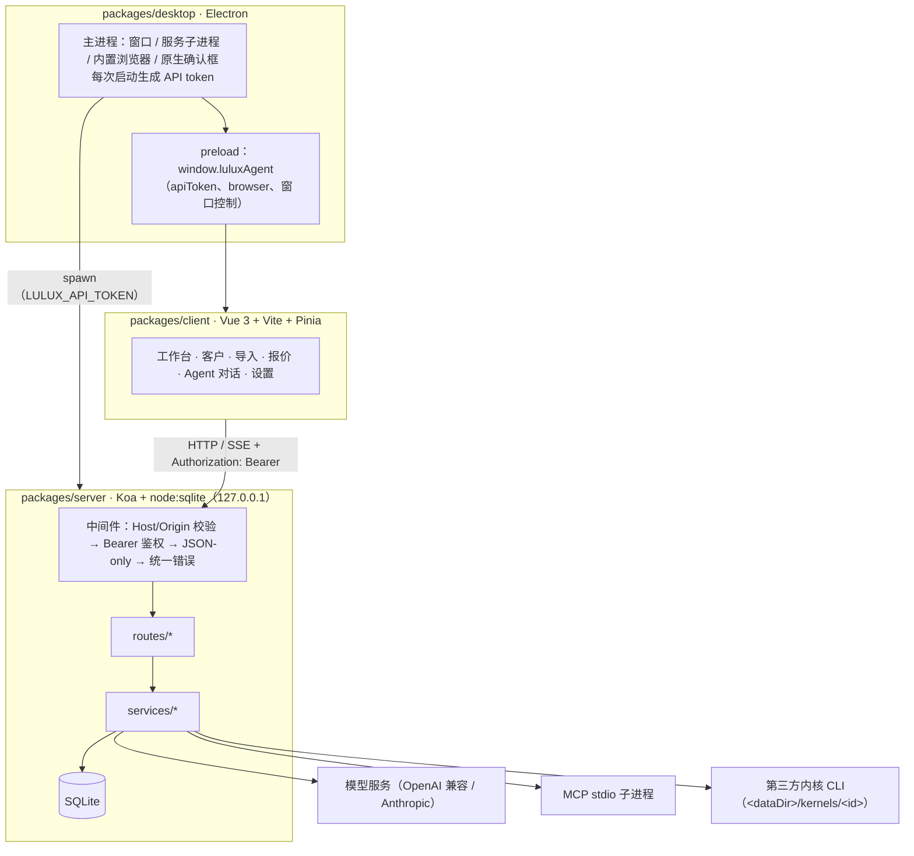

# 架构说明

LULUX ETA 是本地 + 云端（团队服务器）双模式的外贸 AI Agent 工作区：同一套服务端（`packages/server`）既可以由 Electron 桌面端在本机回环地址拉起（**桌面模式**，数据留在这台电脑上），也可以部署在你自己的服务器上供团队用“云端 LULUX”登录（**服务器模式**，`LULUX_MODE=server`，数据留在你的服务器上）。

> 本文描述 v0.1.1 重构后的目标架构，接口细节以 [`docs/API-CONTRACT.md`](./docs/API-CONTRACT.md) 为准；两者不一致时以契约为准，并请同步修正本文。

## 总览



三个包职责单一，互不引用源码：

- `packages/server`：所有业务逻辑与持久化，唯一访问数据库的进程。
- `packages/client`：纯浏览器应用，只通过 `/api` 与 SSE 访问服务端；Excel / CSV 在客户端解析成行再提交。
- `packages/desktop`：窗口生命周期、本地服务子进程、内置浏览器视图与原生对话框，不包含业务逻辑。

## 本地 API 安全边界

服务只为本机这一个用户服务，威胁模型是“同一台电脑上的任意网页与其他进程不应能驱动本地 API”。

| 层 | 规则 |
| --- | --- |
| 监听 | 桌面模式默认 `127.0.0.1`；服务器模式（团队）需部署在 HTTPS 反向代理之后 |
| Host 校验 | 只允许 `127.0.0.1:<port>` / `localhost:<port>`，否则 403（防 DNS Rebinding） |
| Origin 校验 | 若带 `Origin`，必须是服务自身 origin；开发态（`NODE_ENV!=='production'`）额外允许 `http://localhost:5173` / `http://127.0.0.1:5173`，否则 403 |
| 鉴权 | 所有 `/api/*`（含 `/api/health`）要求 `Authorization: Bearer <token>`，否则 401；静态资源不需要 |
| CORS | 不返回任何 CORS 头 |
| 请求体 | 只接受 `application/json`，其他 415 |
| 错误 | `{ "error": { "code", "message" } }`，状态码语义正确 |

token 来源：

- **桌面端**：主进程每次启动 `crypto.randomBytes(32).toString('hex')`，经 `LULUX_API_TOKEN` 传给服务子进程，preload 暴露为 `window.luluxAgent.apiToken`。
- **浏览器开发态**：服务端未收到 `LULUX_API_TOKEN` 时自行生成并写入 `<dataDir>/api-token`（0600）；`vite.config.ts` 的 dev proxy 读取该文件并注入请求头；客户端在没有 `window.luluxAgent` 时不加头。

其他防线：

- **MCP 命令确认**：新增 / 修改 MCP Server 的 command / args / env 时，桌面端由主进程弹出原生确认框显示完整命令，拒绝则 403 `MCP_COMMAND_REJECTED`；开发态无主进程时仅当设置 `allowMcpWithoutNativeConfirm=true`（默认 false）才放行。
- **设置白名单**：`PATCH /api/settings` 只接受 `GET /api/settings/schema` 中声明的键，未知键 400。
- **密钥不出服务端**：Provider 接口返回 `hasApiKey` 与 `apiKeyPreview`（如 `sk-…abcd`），绝不返回明文。
- **产物隔离**：HTML / SVG 预览在 sandbox iframe 中运行，并禁止网络连接，无法访问本地 API。
- **本机锁**：可选 PIN（4–12 位，scrypt 哈希）；默认不启用，未启用时直接进入主界面。

## 服务端分层

```
src/
├── index.ts              # 进程入口、优雅退出
├── app.ts                # Koa 装配：安全中间件、路由、静态托管
├── config.ts             # 环境变量
├── db.ts                 # SQLite 建表与默认值
├── middleware/           # Host/Origin 校验、鉴权、错误格式
├── routes/               # HTTP 边界：参数校验与状态码
├── services/             # 业务逻辑（不感知 HTTP）
│   ├── llm/              # Provider 适配器
│   ├── mcp/              # MCP stdio 客户端与运行时注册表
│   └── kernels/          # 第三方内核安装 / 更新 / 卸载 / 启动
└── utils/                # SSE、ID
```

规则：

1. 路由层不做数据库访问，只调用 service；入参在路由层校验。
2. service 层不感知 HTTP，便于后续被 CLI、服务器模式或其他入口复用。
3. Provider 适配器实现统一的流式接口；新增模型协议只需增加一个适配器并注册。

（目录为目标结构，以 `packages/server/src` 实际为准。）

## 领域模型

| 领域 | 主要实体 | 说明 |
| --- | --- | --- |
| 模型服务 | Provider | 接口类型、Base URL、API Key（仅存本机）、模型列表、默认模型 |
| Agent | Agent（`persona` / `kernel`） | persona 是 LULUX 自有角色（不使用第三方产品名），由 Provider 驱动；kernel 对应已安装的第三方内核，未安装或需登录时 `available=false` |
| 内核 | Kernel | `builtin`（始终已安装）与可安装的第三方 CLI；状态 `idle / installing / uninstalling / error`，含进度与最近 500 行日志 |
| 会话 | Session、SessionMember、Message | 会话成员与发言顺序；助手消息记录发言者、工具调用轨迹与 `runtime` |
| 客户 | Customer、Contact、Activity | 阶段 `lead → contacted → quoted → negotiating → won / lost`，标签、来源；多联系人；跟进动态 |
| 产品与报价 | Product、Quote、QuoteItem | 贸易术语、港口、有效期、付款方式、交期、币种、状态 `draft / sent / accepted / rejected` |
| 模板与规则 | QuoteTemplate、InquiryRule | 报价单抬头与默认值；询盘判定条件、动作与优先级 |
| 工具 | McpServer | 启动命令、参数、环境变量、启停 |
| 设置与安全 | Settings、Lock | 白名单键值设置；本机锁 PIN 哈希 |

SQLite 启用 `journal_mode = WAL` 与 `foreign_keys = ON`。数据导入（`POST /api/data/import`）前自动在 `<dataDir>/backups/` 留快照。

## API 一览

完整定义见契约。分组如下：

| 分组 | 路径 |
| --- | --- |
| 健康检查 | `GET /api/health` |
| 模型服务 | `/api/providers*`、`/api/proxy/test` |
| Agent 与对话 | `GET /api/agents`、`/api/sessions*`、`POST /api/chat`（SSE）、`POST /api/chat/tool-decision` |
| 内核 | `GET /api/kernels`、`POST /api/kernels/:id/{install,update,uninstall}`（202，客户端每秒轮询）、`GET /api/kernels/:id/log` |
| 客户 | `/api/customers*`、`POST /api/customers/import`、`/api/customers/:id/activities` |
| 产品与报价 | `/api/products*`、`/api/quotes*`、`GET /api/quotes/:id/html` |
| 规则与模板 | `/api/inquiry-rules*`、`POST /api/inquiry-rules/test`、`/api/quote-templates*` |
| 工作台 | `GET /api/workbench/summary` |
| MCP | `/api/mcp/servers*` |
| 设置 | `GET/PATCH /api/settings`、`GET /api/settings/schema`、`POST /api/webhook/test` |
| 数据与备份 | `GET /api/data/summary`、`GET /api/data/export`、`POST /api/data/import`、`DELETE /api/data/sessions` |
| 本机锁 | `GET /api/lock`、`POST /api/lock/{setup,verify,disable}` |

**已实现**：邮箱收发（IMAP / SMTP / Google、Microsoft OAuth）、团队与权限（服务器模式）、云端 LULUX 登录。**即将推出**：基于 HS 编码 / 海关提单的开发客户。

## 内核管理

1. `GET /api/kernels` 返回内置条目与可安装内核（名称、厂商、npm 包名、体积提示、是否需要登录及提示）。
2. 安装 / 更新 / 卸载是异步任务：接口立即返回 202 与当前 Kernel，客户端每秒轮询直到 `idle` 或 `error`。
3. 安装源为 `https://registry.npmmirror.com`，安装到 `<dataDir>/kernels/<id>/`，不写全局 npm 前缀。
4. 安装日志保留最近 500 行，可在设置页查看。
5. 选中不可用的 kernel Agent 发消息返回 409 `KERNEL_UNAVAILABLE`。
6. 第三方内核不随 LULUX ETA 分发，受其各自许可协议约束（见 `NOTICE`）。

## 出站请求

所有访问外部的请求都经过 `services/http-client.ts` 的 `fetchWithProxy()`：读取设置中的 `proxyUrl`，非空时用 `undici` 的 `ProxyAgent` 作为 dispatcher。代理地址保存时由 `normalizeProxyUrl()` 补齐 `http://` 并拒绝非 HTTP(S) 协议；同一个地址只缓存一个 agent，地址变化时关闭旧 agent。覆盖范围包括模型对话、`/models` 模型发现、代理连通性测试与 Webhook 推送。

## 聊天数据流

1. 客户端 `POST /api/chat`（JSON：`sessionId`、`content`）。
2. 服务端保存用户消息，读取该会话的成员列表（`session_members`）。
3. 选择会话绑定的 Provider；未绑定则取设置中的默认 Provider，再回退到列表第一个。模型取该 Provider 的默认模型（`provider.model`），并保证它存在于模型列表中。
4. 打开 SSE，发送 `start`（会话、Provider 与成员名单）。
5. 按 `position` 依次让每个成员发言（persona 走 Provider 适配器；kernel Agent 交给对应内核运行，不可用时 409 `KERNEL_UNAVAILABLE`）：先发 `agent` 声明当前发言者，再由适配器把上游流式响应转换为带 `agentId` 的 `delta`。
6. 每位成员完成后保存 assistant 消息（写入发言者与 `runtime`：`{kind:"provider",providerName,model}` 或 `{kind:"kernel",kernelId,version}`，客户端据此在消息头显示实际运行者）并发送 `done`；失败发送 `error` 并结束本轮。发送 `done` 之后触发 `webhookService.notifyChatCompleted()`：开关为开且地址非空时，向 Webhook POST 一条 `chat.completed`（含会话、Provider、Agent 与 200 字回复摘要，不含 API Key），8 秒超时、失败只记日志，不阻塞对话。
7. 客户端断开时 `AbortController` 中止上游请求，已生成的部分内容仍会落库。

群聊历史按「发言者视角」投影：其他 Agent 的历史回复会被改写为用户轮次并加 `【名字】` 前缀，避免模型把它们当成自己说过的话。每位发言者还会收到包含群成员名单与发言规则的独立 system 提示词；会话设置了群聊名称时，提示词会写明「正在名为「X」的多 Agent 群聊中」。

SSE 事件格式：

```
event: agent
data: {"agentId":"analyst","name":"<角色名>","index":0,"total":2}

event: delta
data: {"text":"...","agentId":"analyst"}

event: tool_request
data: {"requestId":"...","agentId":"analyst","name":"mcp_mock_echo","server":"mock","arguments":"{...}","auto":false}

event: tool_result
data: {"requestId":"...","agentId":"analyst","name":"mcp_mock_echo","server":"mock","ok":true,"approved":true,"result":"...","durationMs":12}

event: done
data: {"message":{...}}
```

### 工具调用循环

1. 每轮对话开始时 `mcpRuntime.toolDefinitions()` 汇总所有已启用 Server 的工具；确保连接成功后才把工具交给适配器，未连接则本轮不带工具。
2. 适配器把上游的 `tool_calls` / `tool_use` 归一化为 `{id,name,arguments}`，聊天路由最多循环 `MAX_TOOL_ROUNDS = 4` 轮。
3. 每个调用先发 `tool_request`。`settings.toolApproval === 'auto'` 时直接执行；否则挂起等待 `POST /api/chat/tool-decision`，连接中断、超时或服务端关闭都按拒绝处理。
4. 已知工具经 `mcpRuntime.call()` 走 stdio JSON-RPC；未知工具或已断开的 Server 返回失败结果而不是抛错。结果超过 12k 字符截断。
5. 结果作为工具消息回填历史后进入下一轮；助手文本与 `toolTrace`（参数、结果、批准状态、耗时）一起落库，拒绝也会记录。

## 对话页右侧面板

对话页标题栏有三个互斥的开关：产物、浏览器、会话详情。状态由 `ChatView` 的 `activePanel` 管理，再点同一个按钮即收起；面板与对话区同属 `.workspace`，各自独立滚动。

### 产物

`lib/artifacts.ts` 只读地从已落库的 assistant 消息里提取 fenced code block，不额外入库，也不影响聊天渲染。每个代码块生成 `{id: messageId:index, language, code, title}`：

- 语言标签做归一化（`htm` → `html`、`markdown` → `md` 等），并映射为界面显示名。
- 标题优先取 HTML/SVG/XML 的 `<title>`，否则取第一行有效内容，截断到 48 字符。
- `previewSource()` 为 HTML 原样返回；SVG 包一层居中排版的 HTML 文档；JSON 解析后美化。HTML 与 SVG 用 `<iframe sandbox="allow-scripts" :srcdoc>` 预览，并通过 CSP 禁止网络连接（`connect-src 'none'`），预览内容无法访问本地 API，其余语言按原文显示。
- 复制走 `navigator.clipboard`，下载由 Blob + `<a download>` 完成，文件名经非法字符过滤。

### 内置浏览器

浏览器能力只在桌面端提供，Web 构建在 `lib/window.ts` 里得到 `desktopBrowser = null`，页面显示「内置浏览器只在桌面端可用」的说明。

渲染进程（`BrowserPanel.vue`）只负责标签栏、工具栏与布局：订阅 `luluxAgent.browser.onState()`，把 `.browser-viewport` 的 `getBoundingClientRect()` 通过 `setBounds` 发给主进程，挂载时 `setVisible(true)`、卸载时 `setVisible(false)`。

主进程（`packages/desktop/src/browser.ts`）维护 `Map<tabId, WebContentsView>`：

- 每个标签页是一个 `WebContentsView`，不加载到主渲染进程里，因此网页脚本无法触碰应用界面。
- 统一使用 `persist:lulux-browser` 分区，Cookie、缓存与系统浏览器隔离；该分区拒绝所有权限请求。
- 视图只在面板可见且尺寸非零时 `addChildView`，隐藏时移除；`setBounds` 在数值未变化时跳过。
- `navigationHistory` 提供前进/后退状态；`did-*`、`page-title-updated`、`did-fail-load` 事件触发 `browser:state` 广播。
- 地址栏输入先经 `normalizeInputUrl()`：带协议的地址原样使用，`javascript:` 被丢弃，像搜索词的内容交给 Bing，其余补 `https://`。
- `window.open` 的 HTTP(S) 目标在内置浏览器新建标签页，其余交给系统浏览器。

## MCP 运行时

```
mcp_servers (SQLite)
      │ sync / refresh
      ▼
McpRuntime ── entry: {status, error, tools, connection}
      │ ensureConnected
      ▼
McpConnection ── child_process spawn（stdio）
      │ 换行分隔的 JSON-RPC 2.0
      ▼
initialize → notifications/initialized → tools/list → tools/call
```

- 每个 Server 一个子进程，状态机为 `stopped → connecting → connected | error`；进程意外退出时回调把状态改为 `error` 并清空工具缓存。
- 工具名做 `mcp_${serverSlug}_${sanitize(tool.name)}` 变换，限长 60 字符并用 `_2` 去重，保证同一轮对话里全局唯一。
- `toolDefinitions()` 会按需重连并只返回 `connected` 的 Server 的工具；`call()` 重新解析全名后调用原始工具名。
- 服务启动时 `sync()` 连接所有已启用的 Server；收到 SIGINT / SIGTERM 时 `closeAll()` 先关子进程再关 HTTP。
- 新增 / 修改启动命令须经主进程原生确认（见“本地 API 安全边界”）；子进程只继承白名单环境变量，Windows 下用 `cross-spawn` 处理命令解析。

## 桌面端托管

主进程不再要求外部先启动服务：

1. 主进程生成本次启动的 API token（32 字节随机数），经 `LULUX_API_TOKEN` 传给服务子进程，并通过 preload 暴露给渲染进程。
2. `server.ts` 先用 `net.createServer().listen(0)` 探一个空闲端口，再 spawn 服务进程。
3. 开发态执行 `node packages/server/dist/index.js`；打包态执行 `packages/desktop/resources/server/index.cjs`，由 esbuild 把服务端和 koa/undici 打成一个 CJS 文件。
4. 打包后服务进程的 Node 就是 Electron 自身：设置 `ELECTRON_RUN_AS_NODE=1` 后用 `process.execPath` 启动，因此安装包不需要附带 Node。
5. 子进程带 `LULUX_ETA_PARENT_PIPE=1`，父进程退出时 stdin 关闭，服务端据此收尾 MCP 子进程；主进程 `before-quit` 也会先 `stop()` 再真正退出。
6. 启动失败时窗口内显示错误页（退出码与 stderr 尾部），而不是留一个空白窗口。
7. `LULUX_ETA_SMOKE=1` 提供无界面自检：启动服务、请求健康检查与首页，把结果写到 `LULUX_ETA_SMOKE_OUT` 后退出，可用于打包产物验证。

`server/index.ts` 的 `shutdown()` 做了幂等保护，并带 3 秒强制退出兜底。

主窗口设置 CSP，`will-navigate` 拦截离开应用 origin 的导航；外链交给系统浏览器。渲染进程 `contextIsolation: true`、`nodeIntegration: false`、`sandbox: true`。

## 设置界面

左侧分区：账户与本机（本机锁）、邮箱账户、内核管理、模型与密钥、询盘判定规则、报价模板、数据与备份、团队与权限，以及通用 / 代理 / 通知 / MCP / 外观 / 关于。设置项由 `GET /api/settings/schema` 驱动，客户端不自行发明键。

## 扩展方向（路线图）

- **开发客户**：按 HS 编码与海关提单数据发现潜在客户，给出置信度。
- **数据安全**：SQLCipher 或字段级加密、加密备份。
- **服务器模式**：PostgreSQL、OIDC/SSO。
- **发布**：代码签名与公证。
