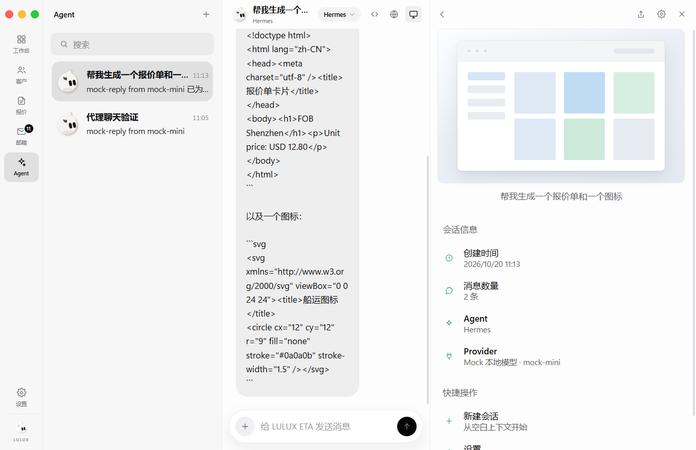
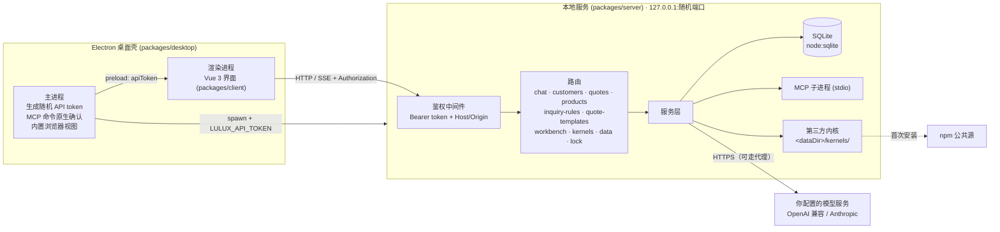

<div align="center">


# LULUX ETA

**面向外贸团队的本地优先 AI Agent 工作台**

客户、报价、询盘规则与 AI 对话都在你自己的电脑上 —— 只有模型请求会发往你自己配置的模型服务。

[English](./README_en.md) · [架构](./ARCHITECTURE.md) · [更新日志](./CHANGELOG.md) · [安全](./SECURITY.md) · [贡献](./CONTRIBUTING.md)


</div>

> [!IMPORTANT]
> LULUX ETA 是**源码可用（source-available）**软件，采用 Business Source License 1.1，**不是 OSI 认可的开源许可证**。个人和组织可以免费在生产环境中使用（包括内部修改），但不能拿去收费分发或做收费托管服务。详见[许可证](#许可证)。

## 截图

<!-- 发布前请用 v0.1.1 新界面替换：docs/screenshots/workbench.png、customers.png、quote.png、kernels.png、chat.png -->


## 项目定位

外贸业务员每天在询盘、客户资料、报价单和开发信之间来回切换。LULUX ETA 把这些放进一个桌面应用，并让 AI Agent 直接在这些数据旁边工作：

- **本地优先**：数据存在本机 SQLite，不需要注册账号，不经过任何 LULUX 服务器。
- **自带模型**：接入你自己的 OpenAI 兼容 / Anthropic 接口（DeepSeek、通义、Moonshot、本地 Ollama 等）。
- **可接入第三方 Agent 内核**：一键安装 Claude Code、Codex CLI、Gemini CLI、Qwen Code 等命令行 Agent（由你的电脑从 npm 公共源下载，不随本软件分发）。

## 功能

### 已可用（v0.1.1）

**外贸业务**

- **工作台**：客户总数与各阶段分布、报价数量与按币种汇总的金额、最近客户动态与最近会话。
- **客户管理**：客户公司、国家、网站、阶段（线索 → 已联系 → 已报价 → 谈判中 → 成交 / 流失）、标签、来源、备注；多联系人（邮箱、电话、WhatsApp）；跟进动态（备注 / 邮件 / 电话 / 报价）；搜索与按阶段、标签筛选。
- **客户导入**：CSV / Excel 在本地解析，字段映射、按邮箱 / 公司 / 网站去重，重复时跳过或合并，导入结果逐行报告。
- **产品与报价**：产品库（SKU、规格、单位、价格、币种、MOQ、HS 编码）；报价单支持 EXW / FOB / CFR / CIF / DDP 等贸易术语、港口、有效期、付款方式、交期、多币种；状态流转（草稿 / 已发送 / 已接受 / 已拒绝）；生成可打印页面并导出 PDF。
- **报价模板**：公司抬头、Logo、默认贸易术语 / 币种 / 付款方式、页脚，可设默认模板。
- **询盘判定规则**：按主题 / 正文 / 发件人 / 域名，用包含、不包含、正则组合条件，判定为询盘 / 垃圾 / 待复核，带优先级，可在设置里用样例邮件测试。

**AI Agent**

- **多模型服务**：OpenAI 兼容接口与 Anthropic Messages API；12 个内置服务商预设，也可自定义 Base URL；从上游拉取模型列表；API Key 在界面中只显示掩码。
- **内核管理**：真实安装 / 更新 / 卸载第三方命令行 Agent，显示版本、进度与日志；安装到 LULUX 数据目录，不污染全局环境。
- **自有角色 + 内核 Agent**：LULUX 自有角色由你配置的模型驱动；已安装的内核以其真实名称出现。每条回复都标明实际运行者（哪个模型服务 / 哪个内核及版本）。
- **流式对话与群聊**：SSE 实时输出、可中断；一个会话可拉入多个 Agent 依次发言。
- **MCP 工具调用**：托管 stdio MCP Server，支持 OpenAI 与 Anthropic 两种工具调用协议；新增或修改启动命令需要原生弹窗确认。
- **工具审批**：默认每次调用前在对话里“允许 / 拒绝”，调用记录随消息保存。
- **产物面板**：自动收集回复中的代码块，HTML / SVG 在隔离沙箱中预览，支持复制与下载。
- **内置浏览器**（桌面端）：多标签，独立会话分区，与系统浏览器 Cookie 隔离。

**数据与安全**

- **备份与恢复**：一键导出 JSON 备份（不含 API Key、代理与 Webhook 地址）；导入恢复前自动在本地留快照。
- **本机锁**：可选 4–12 位 PIN 解锁（默认关闭）。
- **网络代理与完成通知**：HTTP/HTTPS 出站代理；对话完成后推送 Webhook。
- **本地 API 加固**：每次启动随机令牌、Host / Origin 校验、无 CORS，详见[安全模型](#安全模型)。

### 即将推出

以下功能在界面中显示为“即将推出”，当前**不可用**：

- 📮 **邮箱收发**：IMAP 同步、SMTP 发送、163 / QQ 授权码与 Gmail / Outlook OAuth、邮件归档到客户
- 👥 **团队与权限**：多成员、角色与客户可见范围
- 🌐 **远程服务器登录**：连接自建 LULUX 服务端（服务器模式）

## 安装

### 下载安装包

前往 [Releases](../../releases) 下载对应平台的安装包（Windows `.exe` / 便携版、macOS `.dmg`、Linux `AppImage`）。

> 早期版本的安装包可能尚未做代码签名，Windows SmartScreen / macOS Gatekeeper 可能提示风险，请确认来源为本仓库 Releases 后再运行。

### 团队服务器（自建）

同一个 Release 里还提供团队服务器：

- `lulux-eta-server-<版本>.tar.gz`：已编译服务端 + 网页界面 + 生产依赖 + Dockerfile / docker-compose / 部署配置，解压后按内附 `README-server.md` 用 `docker compose up -d` 或 `./start-server.sh`（Node.js 22.13+）启动；
- Docker 镜像：`docker pull ghcr.io/koko2376/lulux-eta:latest`（或指定版本号，如 `:0.1.1`）。

部署步骤见 [docs/deploy-server.md](./docs/deploy-server.md)。

### 首次使用

1. 打开应用，进入 **设置 → 模型与密钥**，添加一个模型服务（选预设、填 API Key）。
2. 回到 **Agent** 页面新建会话开始对话。
3. （可选）在 **设置 → 内核管理** 安装第三方内核；部分内核需要在其厂商处单独登录。

## 开发

要求 Node.js **≥ 22.13**（使用内置 `node:sqlite`）。

```bash
npm ci                 # 若 npm 全局配置了 omit=dev，请用 npm ci --include=dev
npm run dev            # API（http://127.0.0.1:51789）+ Web 界面（http://localhost:51790）
npm run dev:desktop    # 构建后启动 Electron 桌面端
npm run build          # 构建全部包
npm run dist           # 打包桌面安装程序 → packages/desktop/release/
```

浏览器开发态下，服务端把 API token 写入 `<数据目录>/api-token`，Vite 开发代理自动注入请求头。

| 环境变量 | 默认值 | 说明 |
| --- | --- | --- |
| `LULUX_ETA_HOST` | `127.0.0.1` | 监听地址（请保持回环地址） |
| `LULUX_ETA_PORT` | `51789` | API 端口（桌面端使用随机空闲端口） |
| `LULUX_ETA_HOME` | `~/.lulux-eta` | 数据目录（SQLite、备份、内核、api-token） |
| `LULUX_ETA_CLIENT_DIST` | 空 | Web 构建产物目录，设置后由服务端托管 |
| `LULUX_ETA_URL` | 空 | 桌面端改为加载该地址，不再自启本地服务 |

更多见 [CONTRIBUTING.md](./CONTRIBUTING.md)；接口定义见 [docs/API-CONTRACT.md](./docs/API-CONTRACT.md)。

## 架构



详细分层、数据模型与数据流见 [ARCHITECTURE.md](./ARCHITECTURE.md)。

## 安全模型

- 本地服务只监听 `127.0.0.1`；**请勿**暴露到局域网或公网（当前没有多用户隔离）。
- 每次启动生成随机 token，所有 `/api/*` 请求必须携带；校验 `Host` 与 `Origin`，不返回 CORS 头，防止网页跨站调用与 DNS Rebinding。
- MCP 启动命令需原生弹窗确认；Agent 工具调用默认逐次审批；模型生成的 HTML 在沙箱中预览，无法访问本地 API。
- API Key 保存在本机数据目录，接口只返回掩码。请保护好数据目录和备份文件。
- 本机锁是防旁人误用的 PIN，不是数据加密。

发现漏洞请按 [SECURITY.md](./SECURITY.md) 私密报告。

## 许可证

LULUX ETA 采用 **[Business Source License 1.1](./LICENSE)**（MariaDB 官方文本，仅填写参数）。

| 参数 | 值 |
| --- | --- |
| Licensor | koko |
| Licensed Work | LULUX ETA，© 2026 koko |
| Change Date | 2030-10-20 |
| Change License | Apache License, Version 2.0 |

**Additional Use Grant（附加使用授权）中文说明**（以 [LICENSE](./LICENSE) 英文原文为准）：

- ✅ 任何个人或组织都可以**免费**把 LULUX ETA 用于生产环境，包括在组织内部修改并使用修改版。
- ✅ 你可以复制、修改、再分发源码，用于非生产用途（BSL 基础授权）。
- ❌ 不得把本作品或其修改版**向第三方出售、收费分发、再许可**，或作为**收费的托管 / 在线服务（SaaS）**提供。
- ❌ 不得去除或隐藏版权声明，或把本作品或其修改版**声称为自己的原创产品**进行分发。
- ⏳ 每个版本在 Change Date（本版本为 2030-10-20）或首次公开发布满四年时（以先到者为准）自动转为 Apache-2.0。

超出上述范围的用途请联系作者获取单独授权：kokozenshii0308@gmail.com。

BSL 1.1 不是 OSI 认可的开源许可证，GitHub 会将其显示为 “Other”。因此我们称本项目为 **source-available（源码可用）**，而不是“开源”。

## 致谢与商标声明

- 依赖的开源组件及其许可证见 [THIRD_PARTY_LICENSES.md](./THIRD_PARTY_LICENSES.md) 与 [NOTICE](./NOTICE)。
- Claude、Claude Code、Anthropic、Codex、OpenAI、Gemini、Google、Qwen、通义、阿里云等名称和商标归各自权利人所有，本项目仅用于指明对应的第三方软件。**LULUX ETA 与 Anthropic、OpenAI、Google、阿里云及其他模型厂商没有任何隶属、赞助或背书关系。**
- 第三方内核由用户本机从 npm 公共源下载并受其各自许可协议约束，不随 LULUX ETA 分发。
- “LULUX”“LULUX ETA”名称与 Logo 归作者所有，BSL 不授予商标使用权。

## 联系作者 / Contact

- 作者：koko，中国浙江温州
- 邮箱：kokozenshii0308@gmail.com
