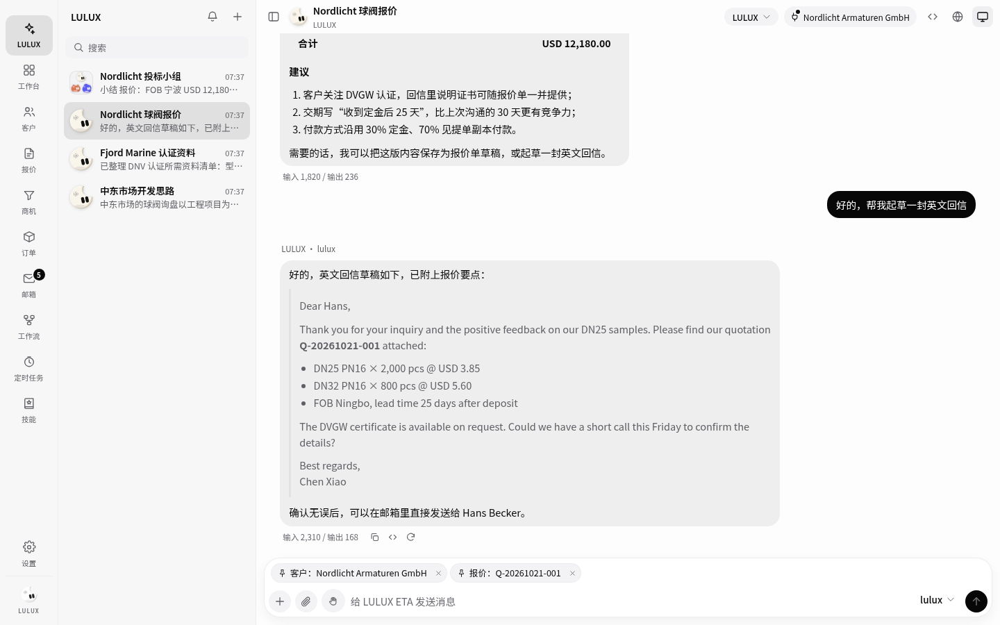
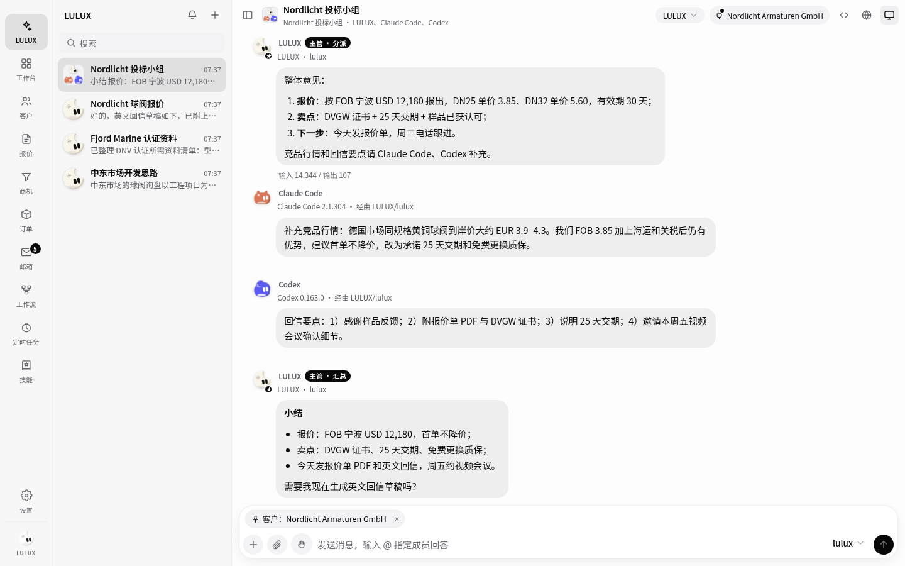
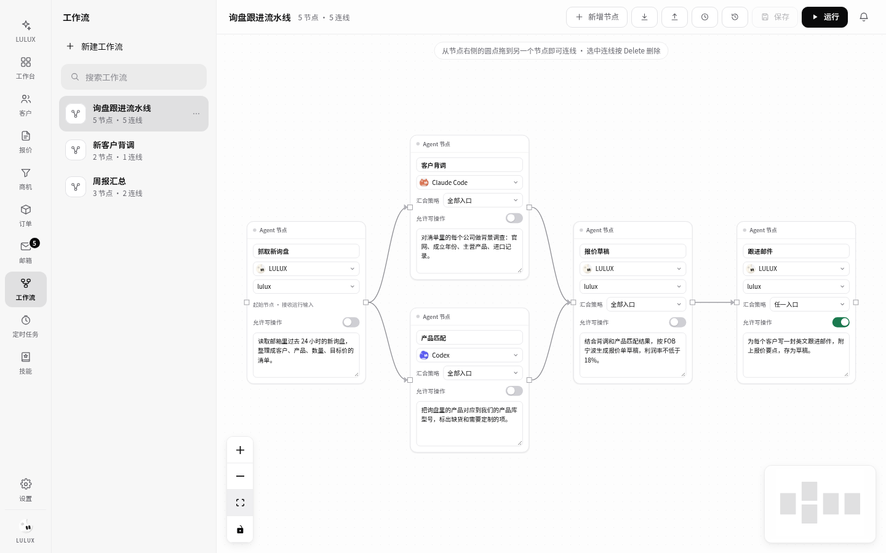
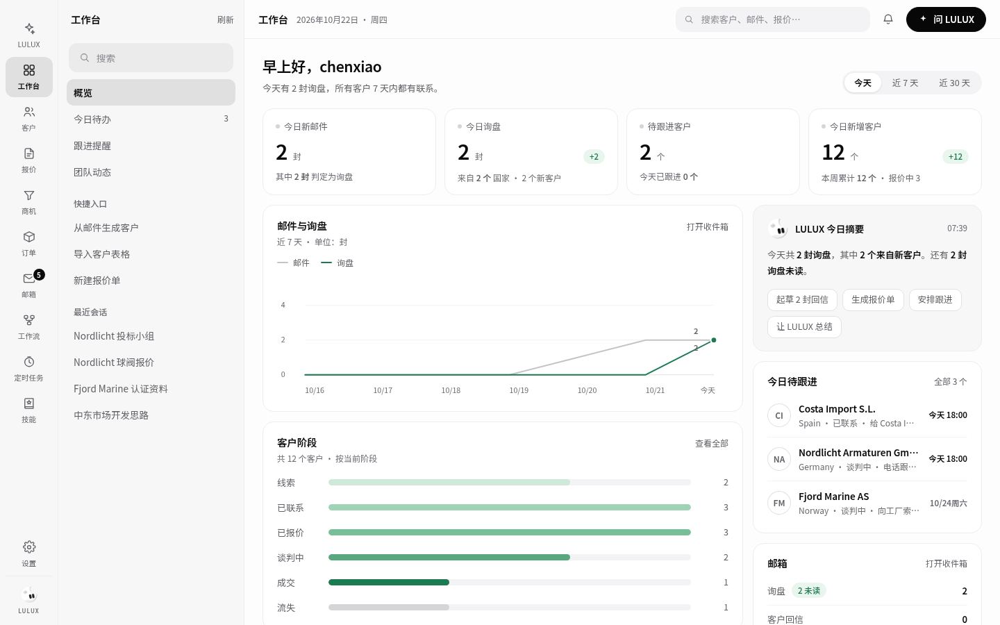
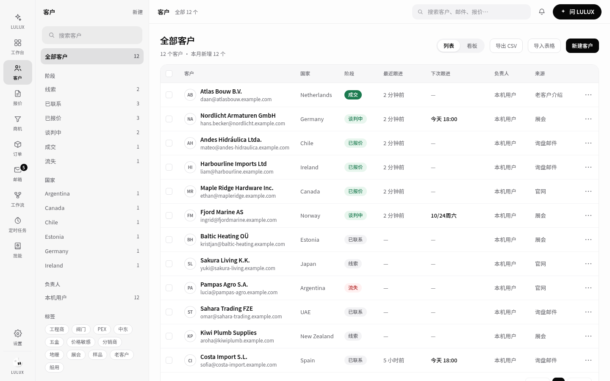
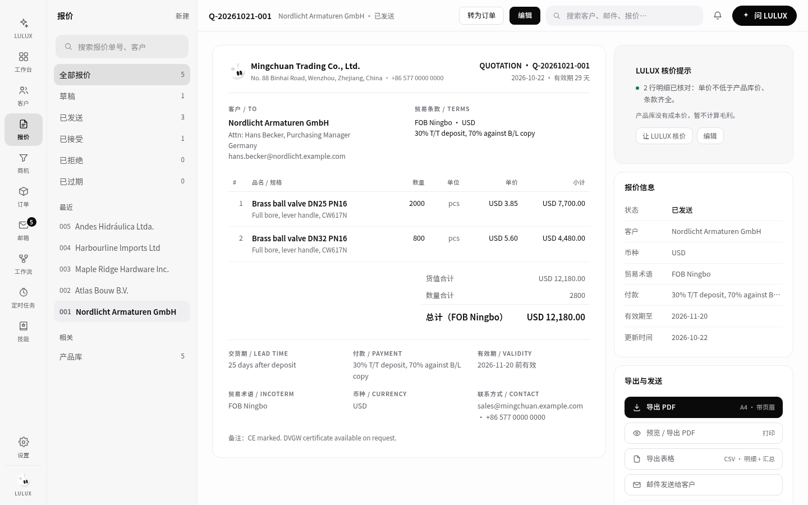
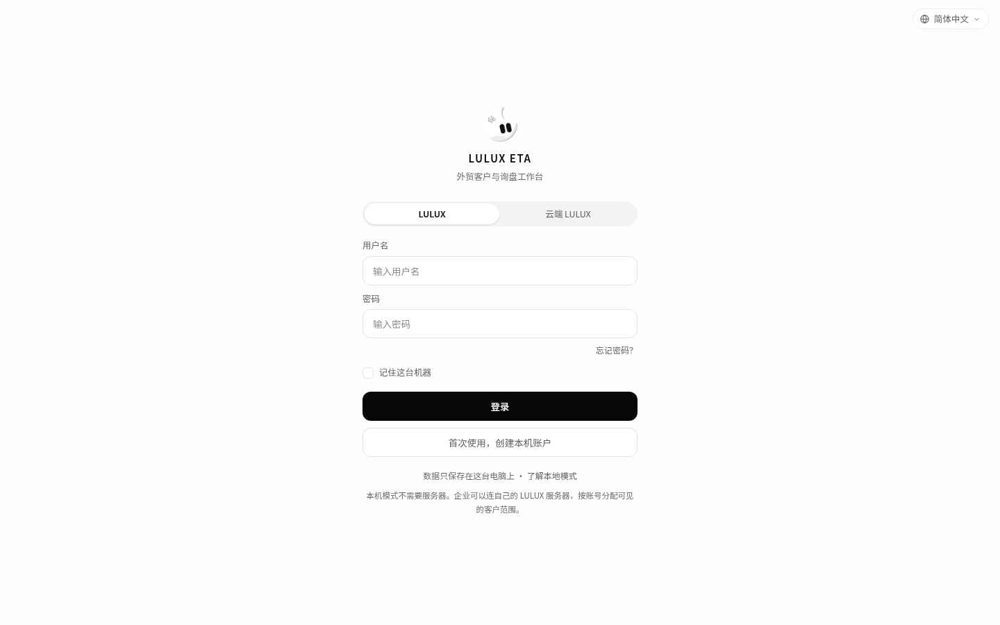
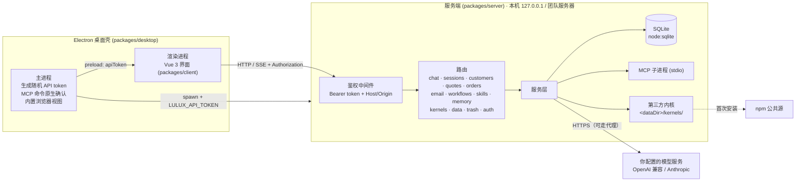

<div align="center">


# LULUX ETA

**本地 + 云端（团队服务器）双模式的外贸 AI Agent 工作区**

一个人用就装桌面版，数据保存在你自己的电脑上；团队用就部署自己的服务器，大家用“云端 LULUX”登录 —— 模型请求只发往你自己配置的模型服务。

[English](./README_en.md) · [架构](./ARCHITECTURE.md) · [更新日志](./CHANGELOG.md) · [安全](./SECURITY.md) · [贡献](./CONTRIBUTING.md) · [社区（QQ 群）](#社区交流)


</div>

> [!IMPORTANT]
> LULUX ETA 是**源码可用（source-available）**软件，采用 Business Source License 1.1，**不是 OSI 认可的开源许可证**。个人和组织可以免费在生产环境中使用（包括内部修改），但不能拿去收费分发或做收费托管服务。详见[许可证](#许可证)。

## 截图



| 多 Agent 群聊 | 工作流画布 |
| --- | --- |
|  |  |
| **工作台** | **客户管理** |
|  |  |
| **报价单** | **登录（LULUX / 云端 LULUX）** |
|  |  |

## 项目定位

外贸业务员每天在询盘、客户资料、报价单和开发信之间来回切换。LULUX ETA 把这些放进一个应用，让 AI Agent 直接在这些业务数据旁边工作。

- **两种运行方式，同一套功能**
  - **桌面模式（LULUX）**：Windows / macOS / Linux 桌面应用，数据存在本机 SQLite，用本机离线账户登录，不经过任何 LULUX 服务器。
  - **团队服务器模式（云端 LULUX）**：把服务端部署在你自己的服务器上（Docker 或 Node.js），客户端切到“云端 LULUX”登录；数据留在你的服务器上，按角色、团队和账户隔离。
- **自带模型**：接入你自己的 OpenAI 兼容 / Anthropic 接口（DeepSeek、通义、Moonshot、本地 Ollama 等）。
- **多种 Agent 内核**：内置 LULUX 内核，另可在设置里安装 Hermes、Claude Code、Codex、Pi、Grok、Gemini CLI、Qwen Code 等命令行 Agent（由你的电脑从 npm 公共源下载，不随本软件分发）。

## 功能（v0.1.1）

### 👥 多 Agent 群聊

把 LULUX 和命令行 Agent 拉进同一个群，像带一个小团队一样分工。

- **主管编排**：群里有一位主管（默认 LULUX，也可以指定其他成员，或不设主管）。你没点名时，主管先给出整体意见并决定派给谁，被派到的成员**依次回答**，最后主管**汇总**结论、分歧和下一步。
- **成员可混搭**：LULUX 内置内核 + Claude Code、Codex、Gemini CLI、Qwen Code、Grok、Hermes、Pi 等已安装的命令行内核；主管按各内核擅长的方向分工。
- **@ 点名**：输入 `@成员名` 直接指定谁来回答，跳过主管派发。
- **每条回复标明实际运行者**：显示成员名、内核版本与所用模型（如“经由 某服务/某模型”）。
- **群头像**：微信风格拼图头像，主管优先，2 / 3 / 4 人自动排布，超过 4 人显示 `+N`。
- **和同事一起（团队服务器）**：可以邀请同组织的同事进群，与 Agent 一起讨论；每条消息显示发送人；所有成员实时看到同一个运行的进度，可以接上观看、审批工具调用、停止运行（只读成员只能观看）。
- **权限与记忆**：群的权限级别对所有 Agent 成员生效；有其他同事的群里，你的长期记忆默认不使用（可手动开启“在群聊中使用我的记忆”），也不会从群聊里提取记忆。

### 🤖 AI Agent 对话

- **服务端运行**：对话完全在服务端执行，关窗、刷新、切会话都不会中断；重新打开会话即接上进度并回放，只有“停止”按钮才会取消。服务重启或崩溃打断的回复会保留已输出内容并标记为中断。
- **会话权限**：输入框旁选择 仅可查看 / 需审批 / 完全权限，按会话保存，作用于内置内核和全部命令行内核；需审批时以卡片确认，可选“本会话始终允许”；无人在线时审批最长等待 30 分钟。
- **模型与推理强度**：输入框右侧选择模型（按模型服务分组）和推理强度（关闭 / 低 / 中 / 高 / 超高，模型不支持的档位置灰），按会话保存。
- **长期记忆**：每个账户独立的“用户画像”和“记忆”，对 LULUX 说“记住……”即可保存；新会话自动带上；可选在对话空闲后自动提取；拒收密钥、密码、卡号等敏感内容；管理员也看不到别人的记忆。
- **技能**：从 zip 包或 GitHub 安装技能，在对话中调用。
- **MCP 工具**：支持 stdio 与 HTTP 两种 MCP 服务器；添加或修改启动命令需桌面端原生弹窗确认。
- **联网搜索与抓取网页**：可配置 Tavily、Brave、SearXNG 或 Bing 兼容接口。
- **输入框上下文**：
  - 顶栏插头：把客户 / 报价**固定**到会话（实线图钉标签）；
  - “+” 菜单：为下一条消息**一次性**引用客户、报价、邮件、商机或订单（虚线标签，发送后清除）；
  - 回形针上传文件，也支持拖拽和粘贴。
- **图片输入**：每条消息最多 8 张图片，交给支持视觉的模型。
- **产物预览**：回复里的代码块自动收进产物面板，HTML 与 SVG 在沙箱中直接预览，JSON、Markdown 和代码可复制或下载。
- **内置浏览器（桌面端）**：在应用内打开网页，可框选区域或选取元素，把截图和页面信息发进当前对话。
- **重新生成 / 编辑后重发**，复制为 Markdown（可含工具调用与用量），整段会话导出 Markdown。
- **命令面板与快捷键**：`Ctrl/⌘+K` 命令面板，`Ctrl/⌘+B` 收起会话列表，`/` 聚焦输入框，`?` 查看全部快捷键。
- **内核管理**：在设置里安装 / 更新 / 卸载命令行内核，显示进度和日志。

### 🧩 工作流与定时任务

- **DAG 工作流画布**：拖拽节点、连线编排多步任务，每个节点可选内核（LULUX 或命令行内核）、模型、提示词、汇合策略（全部入口 / 任一入口）和是否允许写操作；保存时校验无环、无悬空连线。
- 运行详情逐节点显示状态、耗时，可打开节点会话查看过程；工作流可复制、导出、导入 JSON。
- **定时任务**：一次性 / 每隔 N 分钟 / 每天 / 每周 / cron 表达式（按时区），目标可以是一个工作流或一段提示词。
- 工作流节点的写权限不会超过所有者的权限上限。

### 📇 客户（CRM）

- 公司、国家、阶段（线索 → 已联系 → 已报价 → 谈判中 → 成交 / 流失）、标签、来源、负责人、多联系人。
- 列表与看板两种视图，按阶段 / 国家 / 负责人 / 标签筛选；导出 CSV。
- 跟进时间线：备注、电话、邮件、报价记录；下次跟进时间与逾期提示。
- **导入**：CSV / Excel 在本地解析，列映射，按邮箱 / 公司名 / 网站查重，可跳过或合并。
- **查重提醒**：新建或恢复客户时提示组织里可能重复的客户。
- **回收站**：删除的客户等记录进入回收站，30 天内可恢复；客户名下还有报价、商机、订单或收款时拒绝删除并列出数量。
- 客户转移：连带转移报价、商机、订单和未完成任务。

### 📦 产品、报价与订单

- **产品库**：SKU、品名、规格、单位、单价、币种、MOQ、HS 编码。
- **报价单**：贸易术语（FOB / CIF / CFR 等）与港口、多币种、付款方式、交期、有效期、状态；报价模板（公司抬头、Logo、默认术语与条款、页脚）；导出带抬头的 A4 PDF、打印预览、导出表格（CSV），可作为附件随邮件发送；LULUX 核价提示。在对话里也可以让 LULUX 查询、新建、修改报价并生成报价 / PI 的 PDF。
- **商机**：按阶段分列的看板，可拖动改阶段，输单需填写原因；漏斗统计。
- **订单**：由已接受的报价一键生成；生产与发货状态，柜型、柜号、提单号、船名、ETD / ETA。
- **收款与应收**：登记收款（金额、日期、方式、备注），应收汇总。
- **任务与提醒**：任务可关联客户、设置到期时间和优先级，到期时提醒一次；工作台汇总今日待办和跟进提醒。
- **工作台**：今日新邮件 / 询盘 / 待跟进 / 新增客户，近 7 / 30 天邮件与询盘趋势，客户阶段分布，LULUX 今日摘要。

### ✉️ 邮箱

- IMAP 收信 / SMTP 发信，预设 Gmail、Outlook.com、Microsoft 365、QQ 邮箱、腾讯企业邮、网易 163、网易 126、阿里企业邮箱、Zoho Mail，另可自定义；Gmail / Microsoft 支持 OAuth 授权。
- 来信自动关联客户；**询盘判定规则**按主题 / 正文 / 发件人 / 域名组合条件（包含 / 不包含 / 正则）标记询盘、垃圾或待复核，并可用样例邮件测试规则。
- **AI 起草回信**：原邮件作为不可信的外部内容交给模型，其中的指令不会被执行；生成的只是草稿，**发送前一定由你点击确认**。

### 🏢 团队服务器（自建）

- **角色**：所有者 / 管理员 / 成员 / 只读；团队、邀请码与邀请链接（可限定邮箱、有效期、使用次数）。
- **可见范围**：客户、邮箱账户可设为仅自己 / 团队 / 全组织；会话、工作流、定时任务只本人可见。
- **权限上限**：管理员可按角色或成员限制最高权限级别，服务端强制执行。
- **审计日志**：按操作人、时间、类别（模型密钥、导入导出、邮箱、登录等）查询。
- **离职交接**：把一个成员的客户、报价、商机、订单、未完成任务、邮箱账户、工作流和定时任务转给另一位成员。
- 管理员重置密码后强制成员重新设置；管理员访问成员邮箱需单独开启，且每次查看和代发都记入审计。
- **用量与限流**：按日期 / 模型 / 模型服务 / 用途 / 成员统计调用次数、Token 与估算费用（单价自行配置）；按成员限制同时进行的对话数和每分钟发起数。
- 客户端与服务器版本不兼容时给出提示。

### 🖥️ 桌面端

- 系统托盘（关窗最小化到托盘，定时任务和邮箱同步继续运行）、开机自启动。
- 通过 GitHub Releases 自动更新，也可配置自定义更新源。
- 一键导出诊断包（日志自动脱敏）；本地服务意外退出时自动重启。
- “记住这台机器”（会话由系统安全存储加密保存）、登录页语言选择、本机账户恢复码（忘记密码时重设）、可选本机 PIN 锁。
- 有对话在运行时关闭窗口会先确认。

### 💾 数据与安全

- 每 24 小时自动数据库快照（保留最近 7 份，可调），可在设置里管理备份与快照；JSON 导出 / 导入，导入前自动快照。
- API Key 与邮箱凭据用主密钥加密存储，接口只返回掩码；导出的备份不含 API Key、代理与 Webhook 地址。
- HTTP / HTTPS 代理；对话完成通知 Webhook。
- 界面与服务端提示支持简体中文和 English。

### 即将推出

- 🔎 **找新客户**：基于 HS 编码 / 海关提单数据挖掘潜在买家。

## 安装

### 下载安装包

前往 [Releases](https://github.com/koko2376/lulux-eta/releases) 下载。Windows / macOS / Linux 安装包以 Release 页实际文件为准。

> 早期版本的安装包可能尚未做代码签名，Windows SmartScreen / macOS Gatekeeper 可能提示风险，请确认来源为本仓库 Releases 后再运行。

### 团队服务器（自建）

同一个 Release 里还提供团队服务器：

- `lulux-eta-server-<版本>.tar.gz`：已编译服务端 + 网页界面 + 生产依赖 + Dockerfile / docker-compose / 部署配置，解压后按内附 `README-server.md` 用 `docker compose up -d` 或 `./start-server.sh`（Node.js 22.13+）启动；
- Docker 镜像：`docker pull ghcr.io/koko2376/lulux-eta:latest`（或指定版本号，如 `:0.1.1`）。

服务器必须放在 HTTPS（TLS）反向代理之后对外提供。部署步骤见 [docs/deploy-server.md](./docs/deploy-server.md)。

### 首次使用

1. 打开应用，在 **LULUX** 标签创建本机离线账户，并保存好恢复码（使用团队服务器则切到 **云端 LULUX** 标签登录）。
2. 进入 **设置 → 模型与密钥**，添加一个模型服务（选预设、填 API Key）。
3. 回到 **LULUX** 页面新建会话开始对话；可选在 **设置 → 内核管理** 安装命令行内核（部分内核需要在其厂商处单独登录）。

## 开发

要求 Node.js **≥ 22.13**（使用内置 `node:sqlite`）。

```bash
npm ci                 # 若 npm 全局配置了 omit=dev，请用 npm ci --include=dev
npm run dev            # API（http://127.0.0.1:51789）+ Web 界面（http://localhost:51790）
npm run dev:desktop    # 构建后启动 Electron 桌面端
npm run build          # 构建全部包
npm run dist           # 打包桌面安装程序 → packages/desktop/release/
```

浏览器开发态下，服务端把 API token 写入 `<数据目录>/api-token`，Vite 开发代理自动注入请求头。

| 环境变量 | 默认值 | 说明 |
| --- | --- | --- |
| `LULUX_ETA_HOST` | `127.0.0.1` | 监听地址（桌面模式请保持回环地址；服务器模式见部署文档） |
| `LULUX_ETA_PORT` | `51789` | API 端口（桌面端使用随机空闲端口） |
| `LULUX_ETA_HOME` | `~/.lulux-eta` | 数据目录（SQLite、快照、内核、api-token） |
| `LULUX_ETA_CLIENT_DIST` | 空 | Web 构建产物目录，设置后由服务端托管 |
| `LULUX_ETA_URL` | 空 | 桌面端改为加载该地址，不再自启本地服务 |

更多见 [CONTRIBUTING.md](./CONTRIBUTING.md)；接口定义见 [docs/API-CONTRACT.md](./docs/API-CONTRACT.md)。

## 架构



详细分层、数据模型与数据流见 [ARCHITECTURE.md](./ARCHITECTURE.md)。

## 安全模型

- 桌面模式下服务只监听 `127.0.0.1`；每次启动生成随机 token，所有 `/api/*` 请求必须携带；校验 `Host` 与 `Origin`，不返回 CORS 头，防止跨站调用与 DNS Rebinding。
- 服务器模式必须放在 HTTPS（TLS）反向代理之后，只接受 `LULUX_PUBLIC_ORIGIN` 白名单中的地址；不要把服务端口直接暴露到公网。
- API Key 与邮箱凭据用主密钥加密后存储，接口只返回掩码。请保护好数据目录和备份文件。
- MCP 启动命令需原生弹窗确认；工具调用受会话权限控制；模型生成的 HTML 在沙箱中预览，无法访问本地 API。
- 本机 PIN 锁防旁人误用，不是数据加密。

发现漏洞请按 [SECURITY.md](./SECURITY.md) 私密报告。

## 许可证

LULUX ETA 采用 **[Business Source License 1.1](./LICENSE)**（MariaDB 官方文本，仅填写参数）。

| 参数 | 值 |
| --- | --- |
| Licensor | koko |
| Licensed Work | LULUX ETA，© 2026 koko |
| Change Date | 2030-10-20 |
| Change License | Apache License, Version 2.0 |

**Additional Use Grant（附加使用授权）中文说明**（以 [LICENSE](./LICENSE) 英文原文为准）：

- ✅ 任何个人或组织都可以**免费**把 LULUX ETA 用于生产环境，包括在组织内部修改并使用修改版。
- ✅ 你可以复制、修改、再分发源码，用于非生产用途（BSL 基础授权）。
- ❌ 不得把本作品或其修改版**向第三方出售、收费分发、再许可**，或作为**收费的托管 / 在线服务（SaaS）**提供。
- ❌ 不得去除或隐藏版权声明，或把本作品或其修改版**声称为自己的原创产品**进行分发。
- ⏳ 每个版本在 Change Date（本版本为 2030-10-20）或首次公开发布满四年时（以先到者为准）自动转为 Apache-2.0。

超出上述范围的用途请联系作者获取单独授权：kokozenshii0308@gmail.com。

BSL 1.1 不是 OSI 认可的开源许可证，GitHub 会将其显示为 “Other”。因此我们称本项目为 **source-available（源码可用）**，而不是“开源”。

## 致谢与商标声明

- 依赖的开源组件及其许可证见 [THIRD_PARTY_LICENSES.md](./THIRD_PARTY_LICENSES.md) 与 [NOTICE](./NOTICE)。
- Claude、Claude Code、Anthropic、Codex、OpenAI、Gemini、Google、Qwen、通义、阿里云等名称和商标归各自权利人所有，本项目仅用于指明对应的第三方软件。**LULUX ETA 与 Anthropic、OpenAI、Google、阿里云及其他模型厂商没有任何隶属、赞助或背书关系。**
- 第三方内核由用户本机从 npm 公共源下载并受其各自许可协议约束，不随 LULUX ETA 分发。
- “LULUX”“LULUX ETA”名称与 Logo 归作者所有，BSL 不授予商标使用权。

## 社区交流

欢迎加入 **LULUX 社区** QQ 群交流使用心得、反馈问题和建议：群号 **732249109**（或用 QQ 扫码）。


Bug 与功能建议也欢迎直接提 [GitHub Issues](https://github.com/koko2376/lulux-eta/issues)。

## 联系作者 / Contact

- 作者：koko，中国浙江温州
- 邮箱：kokozenshii0308@gmail.com
