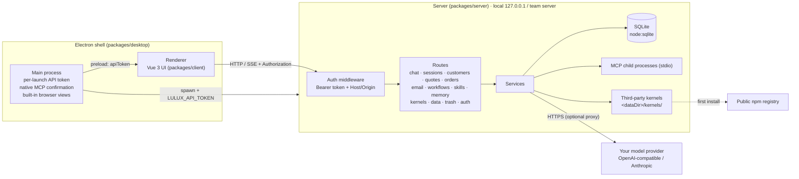

<div align="center">


# LULUX ETA

LULUX ETA (LULUX External Trade Agent)

**A foreign-trade AI agent workspace that runs locally on your desktop or on your own team server**

Working solo? Install the desktop app and your data stays on your computer. Working as a team? Deploy your own server and sign in with “LULUX Cloud”. Either way, model requests go only to the model provider you configure.

[中文](./README.md) · [Architecture](./ARCHITECTURE.md) · [Changelog](./CHANGELOG.md) · [Security](./SECURITY.md) · [Contributing](./CONTRIBUTING.md) · [Community](#community)


</div>

> [!IMPORTANT]
> LULUX ETA is **source-available** software under the Business Source License 1.1. It is **not** an OSI-approved open source license. Individuals and organizations may use it in production for free (including modifying it internally), but may not sell it, distribute it for a fee, or offer it as a paid hosted service. See [License](#license).

## Screenshots

> Screenshots show the Simplified Chinese UI; English is available in Settings → Appearance and on the sign-in page.


| Multi-agent group chat | Workflow canvas |
| --- | --- |
|  |  |
| **Workbench** | **Customers** |
|  |  |
| **Quotation** | **Sign-in (LULUX / LULUX Cloud)** |
|  |  |

## Why LULUX ETA

Export sales reps spend their day jumping between inquiries, customer records, quotations and outreach emails. LULUX ETA puts all of that in one app and lets AI agents work right next to your business data.

- **Two ways to run it, one feature set**
  - **Desktop mode (LULUX):** a Windows / macOS / Linux app. Data lives in a local SQLite database behind a local offline account; no LULUX servers in the loop.
  - **Team server mode (LULUX Cloud):** deploy the server on your own infrastructure (Docker or Node.js) and switch the client to “LULUX Cloud”. Data stays on your server, isolated by role, team and account.
- **Bring your own model:** any OpenAI-compatible or Anthropic API (DeepSeek, Qwen, Moonshot, local Ollama, and more).
- **Multiple agent kernels:** the built-in LULUX kernel, plus CLI agents you can install from Settings — Hermes, Claude Code, Codex, Pi, Grok, Gemini CLI, Qwen Code. They are downloaded by your machine from public npm registries and are not bundled with this software.

## Features (v0.1.2)

### ✨ New in v0.1.2

Every new capability is also an agent tool: the built-in kernel calls it directly, CLI kernels call it through the LULUX MCP, and workflow agent nodes can use it too.

- **Prospecting**: Customers → Leads. UK HMRC importer records by HS code, UN Comtrade market size and growth, and website background checks via search. Leads are labelled “customs evidence” or “website only”, scored, importable from CSV / Excel, and converted to customers with de-duplication.
- **Sanctions screening**: OFAC, EU and UN lists with fuzzy matching, updated daily by default; checked automatically when saving leads, enrolling sequences and scoring inquiries.
- **Quotation engine**: cost → EXW / FOB / CFR / CIF / DDP with export rebate, freight tables (CSV / Excel import), automatic container choice, live FX with manual rate locks, and margin / markup / target-price modes; one sentence produces a PI. Costs, margins and FX rates never appear on the PI.
- **Inquiry scoring**: an A–D grade with reasons for every inquiry (company domain, specifics, signature, phishing / payment-fraud / sanctions risk), the questions to ask back, and a one-click first-reply draft (saved, never sent). Sort the mailbox by score.
- **Outreach sequences**: multi-step cold emails scheduled in the recipient's local working hours, drafts for your review by default (auto-send is opt-in and the agent can't turn it on), daily caps, and automatic stop on reply / unsubscribe / bounce with a suppression list.
- **Shipping documents**: commercial invoice, packing list and certificate-of-origin drafts (PDF) from an order, with a live missing-field check and HS code suggestions.
- **Browser use (desktop)**: the agent opens pages in the built-in browser, reads, clicks, types and selects; a status bar shows each step with Take over / Resume / Stop; password fields are always refused and submit / pay / delete-type clicks ask even in Full access; denied domains and a step limit.
- **Computer use (experimental, off by default)**: per-chat opt-in screenshot + mouse / keyboard control, step-by-step approval, an emergency-stop shortcut, and an automatic pause when you move the mouse.
- **Group chats**: the same kernel can join several times (e.g. LULUX as merchandiser, LULUX #2 as translator), each member with a title badge, duties and its own model; create, edit and post to groups with one sentence; a new “group discussion” workflow node.
- **New interface**: one sidebar with six entries (LULUX / Workbench / Customers / Mailbox / Workflows / Skills) and settings at the bottom; conversations grouped by day; a welcome screen; a two-row message box; colour-coded permissions (Read only green / Ask blue / Full access red); a spectrum reasoning-effort slider; a shimmering “Generating” label; softer cards and menus.

### 👥 Multi-agent group chat

Put LULUX and CLI agents in one group and run them like a small team.

- **Supervisor orchestration:** each group has a supervisor (LULUX by default; any other member, or none). When you don't name anyone, the supervisor gives its take and decides who should answer; dispatched members **reply in turn**, then the supervisor **summarizes** the conclusion, disagreements and next steps.
- **Mix and match members:** the built-in LULUX kernel plus any installed CLI kernel — Claude Code, Codex, Gemini CLI, Qwen Code, Grok, Hermes, Pi. The supervisor splits the work by what each kernel is good at.
- **@mentions:** type `@name` to pick who answers and skip the supervisor's dispatch.
- **Every reply shows who actually ran it:** member name, kernel version and the model used (“via provider/model”).
- **Group avatar:** Grid avatar, supervisor first; 2 / 3 / 4 members laid out automatically, `+N` beyond four.
- **With colleagues (team server):** invite people from your organization into the group to work alongside the agents. Messages show the sender; everyone sees the same live run and can reattach to it, approve its tool calls or stop it (viewers can watch but not stop).
- **Permissions & memory:** the group's permission level applies to every agent member. In groups with other people your long-term memory is not used unless you turn on “Use my memory in group chats” (off by default), and memory is never extracted from them.

### 🤖 AI agent chat

- **Runs on the server:** closing the window, reloading or switching chats doesn't stop a run; reopening a chat reattaches and replays its progress, and only Stop cancels it. Replies cut short by a server restart or crash keep their output and are marked as interrupted.
- **Per-chat permissions:** pick Read only / Ask for approval / Full access next to the message box, saved per chat and applied to the built-in kernel and every CLI kernel. Under Ask, tools need an approval card (“always allow in this session” available); approvals in an unattended run wait up to 30 minutes.
- **Model & reasoning effort:** choose the model (grouped by provider) and effort (Off / Low / Medium / High / Extra high; unsupported levels greyed out) at the right of the message box, saved per chat.
- **Long-term memory:** a per-account Profile and Notes. Tell LULUX “remember …” to save something; every new chat starts with your memory; optional background extraction when a chat goes idle; credentials such as API keys, passwords and card numbers are refused; admins can't read other people's memory.
- **Skills:** install skills from a zip file or GitHub and use them in chat.
- **MCP tools:** stdio and HTTP MCP servers; adding or changing a launch command requires a native confirmation in the desktop app.
- **Web search & page fetch:** Tavily, Brave, SearXNG or a Bing-compatible endpoint.
- **Composer context:**
  - the plug button in the header **pins** a customer / quotation to the chat (solid pin chips);
  - the “+” menu attaches a customer, quotation, email, deal or order **to the next message only** (dashed chips, cleared after sending);
  - “Upload attachment” in the “+” menu uploads files; drag-and-drop and paste work too.
- **Image input:** up to 8 images per message for vision-capable models.
- **Artifacts:** code blocks in replies are collected in the artifacts panel; HTML and SVG preview in a sandbox, JSON, Markdown and code can be copied or downloaded.
- **Built-in browser (desktop):** open pages inside the app, select a region or pick an element, and send the screenshot and page info to the current chat.
- **Regenerate / edit and resend**, copy as Markdown (optionally with tool calls and usage), export a whole chat as Markdown.
- **Command palette & shortcuts:** `Ctrl/⌘+K` command palette, `Ctrl/⌘+B` collapse the chat list, `/` focus the message box, `?` show all shortcuts.
- **Kernel manager:** install / update / uninstall CLI kernels from Settings with progress and logs.
- **CLI kernels use LULUX's local model gateway:** Claude Code, Codex, Gemini CLI, Qwen Code, Hermes, Pi and Grok run on the models you configured in LULUX, with no separate API key setup in each CLI. LULUX serves Anthropic / OpenAI / Gemini-compatible endpoints on localhost and translates between protocols; each run gets a one-time token that is revoked when the run ends, and your real API keys are never handed to the CLI.

### 🧩 Workflows & schedules

- **DAG workflow canvas:** drag nodes and connect them into multi-step jobs. Each node picks its kernel (LULUX or a CLI kernel), model, prompt, join strategy (all inputs / any input) and whether it may write; saving rejects cycles and dangling edges.
- Run details show each node's status and duration, and you can open a node's chat to see what it did. Workflows can be duplicated, exported and imported as JSON.
- **Schedules:** once / every N minutes / daily / weekly / cron (time-zone aware), targeting a workflow or a prompt.
- Workflow nodes never write beyond their owner's permission cap.

### 📇 Customers (CRM)

- Company, country, stage (lead → contacted → quoted → negotiating → won / lost), tags, source, owner, multiple contacts.
- List and board views; filter by stage / country / owner / tag; export CSV.
- Follow-up timeline (notes, calls, emails, quotations), next follow-up date with overdue badges.
- **Import:** CSV / Excel parsed locally with column mapping and de-duplication by email / company / website (skip or merge).
- **Duplicate warnings** when creating or restoring a customer that may already exist in the organization.
- **Recycle bin:** deleted customers and other records can be restored for 30 days; a customer that still has quotations, deals, orders or payments can't be deleted (the counts are shown).
- Customer transfer moves the related quotations, deals, orders and open tasks along with it.

### 📦 Products, quotations & orders

- **Product catalogue:** SKU, name, spec, unit, price, currency, MOQ, HS code.
- **Quotations:** Incoterms (FOB / CIF / CFR …) and port, multi-currency, payment terms, lead time, validity, status; quotation templates (letterhead, logo, default terms, footer); A4 PDF with letterhead, print preview, table export (CSV), attach the PDF when emailing the customer; LULUX price check hints. In chat, LULUX can also look up, draft and update quotations and generate the quotation / PI PDF.
- **Deals:** a stage board with drag-and-drop (a reason is required when a deal is lost) and funnel stats.
- **Orders:** created from an accepted quotation in one click; production and shipping status, container type and number, B/L number, vessel, ETD / ETA.
- **Payments & receivables:** record payments (amount, date, method, reference) and see what is still receivable.
- **Tasks & reminders:** tasks linked to customers with due time and priority, one reminder when due; the workbench gathers today's to-dos and follow-ups.
- **Workbench:** today's new emails / inquiries / follow-ups / new customers, 7- and 30-day email and inquiry trends, customer stage breakdown, a daily LULUX summary.

### ✉️ Mailbox

- IMAP / SMTP with presets for Gmail, Outlook.com, Microsoft 365, QQ Mail, Tencent Exmail, NetEase 163, NetEase 126, Alibaba Mail and Zoho Mail, plus custom servers; OAuth for Gmail and Microsoft.
- Incoming mail is linked to customers automatically. **Inquiry rules** combine subject / body / sender / domain conditions (contains / does not contain / regex) to mark mail as inquiry, spam or needs review, with a tester that runs a rule against a sample email.
- **AI reply drafts:** the original email is passed to the model as untrusted external content, so instructions inside it are not followed. It only produces a draft — **sending always takes your click**.

### 🏢 Team server (self-hosted)

- **Roles:** owner / admin / member / viewer; teams, invite codes and links (optionally limited to an email, with expiry and use count).
- **Visibility:** customers and mailbox accounts can be private, team-wide or organization-wide; chats, workflows and schedules are private to their owner.
- **Permission caps:** admins can cap the highest permission level per role or per member, enforced by the server.
- **Audit log:** filter by actor, time and category (model keys, import/export, mailbox, sign-in and more).
- **Offboarding handover:** move a member's customers, quotations, deals, orders, open tasks, mailbox accounts, workflows and schedules to another member.
- A password reset by an admin forces the member to set a new one; admin access to members' mailboxes is a separate switch, and every view or send-as is audited.
- **Usage & rate limits:** calls, tokens and estimated cost by day / model / provider / purpose / member (you set the prices); per-member limits on concurrent chats and chats started per minute.
- A notice when the client and server versions are incompatible.

### 🖥️ Desktop app

- System tray (close to tray; schedules and mail sync keep running) and start at login.
- Auto-update from GitHub Releases, or from a custom update feed.
- One-click diagnostics bundle (logs redacted); the local server restarts automatically if it exits unexpectedly.
- “Remember this computer” (session encrypted with the OS secure storage), language picker on the sign-in page, local account recovery code for password resets, optional local PIN lock.
- Asks before closing the window while chats are running.

### 💾 Data & security

- Automatic database snapshots every 24 hours (latest 7 kept, configurable), managed in Settings; JSON export / import with an automatic snapshot before importing.
- API keys and mail credentials are encrypted with a master key and only returned masked; exported backups contain no API keys, proxy or Webhook URLs.
- HTTP / HTTPS proxy; chat-completed Webhook notifications.
- UI and server messages in Simplified Chinese and English.

### Coming soon

- 🔎 **Customer discovery:** find potential buyers from HS codes and customs bill-of-lading data.

## Installation

### Installers

Download from [Releases](https://github.com/koko2376/lulux-eta/releases). Available Windows / macOS / Linux installers are whatever files the Release page lists.

> Early builds may not be code-signed yet, so Windows SmartScreen or macOS Gatekeeper may warn you. Only run installers downloaded from this repository's Releases page.

### Team server (self-hosted)

The same Release also ships the team server:

- `lulux-eta-server-<version>.tar.gz` — compiled server + web UI + production dependencies + Dockerfile / docker-compose / deploy configs. Unpack it and follow the bundled `README-server.md`: `docker compose up -d`, or `./start-server.sh` with Node.js 22.13+.
- Docker image: `docker pull ghcr.io/koko2376/lulux-eta:latest` (or a version tag such as `:0.1.2`).

Run the server behind an HTTPS (TLS) reverse proxy. See [docs/deploy-server.md](./docs/deploy-server.md) for the deployment guide.

### First run

1. Open the app and create a local offline account on the **LULUX** tab; keep the recovery code safe (for a team server, use the **LULUX Cloud** tab instead).
2. Open **Settings → Models & Keys** and add a provider (pick a preset, paste your API key).
3. Go to **LULUX**, start a new session, and chat. Optional: install a CLI kernel under **Settings → Kernels** (some require a separate login with their vendor).

## Development

Requires Node.js **≥ 22.13** (uses the built-in `node:sqlite`).

```bash
npm ci                 # use `npm ci --include=dev` if your npm config omits dev deps
npm run dev            # API (http://127.0.0.1:51789) + web UI (http://localhost:51790)
npm run dev:desktop    # build, then launch the Electron app
npm run build          # build all packages
npm run dist           # build desktop installers → packages/desktop/release/
```

In browser dev mode the server writes the API token to `<dataDir>/api-token` and the Vite dev proxy injects it.

| Variable | Default | Description |
| --- | --- | --- |
| `LULUX_ETA_HOST` | `127.0.0.1` | Listen address (keep it on loopback in desktop mode; see the deploy guide for server mode) |
| `LULUX_ETA_PORT` | `51789` | API port (the desktop app picks a random free port) |
| `LULUX_ETA_HOME` | `~/.lulux-eta` | Data directory (SQLite, snapshots, kernels, api-token) |
| `LULUX_ETA_CLIENT_DIST` | empty | Built web UI to be served by the server |
| `LULUX_ETA_URL` | empty | Desktop app loads this URL instead of starting a local server |

See [CONTRIBUTING.md](./CONTRIBUTING.md) and the API contract in [docs/API-CONTRACT.md](./docs/API-CONTRACT.md).

## Architecture



Layers, data model, and data flows are described in [ARCHITECTURE.md](./ARCHITECTURE.md).

## Security model

- In desktop mode the server listens on `127.0.0.1` only; a random token is generated on every launch and required on every `/api/*` request; `Host` and `Origin` are validated and no CORS headers are sent, blocking cross-site calls and DNS rebinding.
- Server mode must run behind an HTTPS (TLS) reverse proxy and only accepts origins listed in `LULUX_PUBLIC_ORIGIN`; never expose the server port directly to the internet.
- API keys and mailbox credentials are stored encrypted with a master key and only returned masked. Protect your data directory and backups.
- MCP launch commands need native confirmation; tool calls follow the chat's permission level; model-generated HTML is previewed in a sandbox that cannot reach the local API.
- The local PIN lock guards against casual access; it is not encryption.

Please report vulnerabilities privately as described in [SECURITY.md](./SECURITY.md).

## License

LULUX ETA is licensed under the **[Business Source License 1.1](./LICENSE)** (the official MariaDB text with only the Parameters filled in).

| Parameter | Value |
| --- | --- |
| Licensor | koko |
| Licensed Work | LULUX ETA, © 2026 koko |
| Change Date | 2030-10-20 |
| Change License | Apache License, Version 2.0 |

**Additional Use Grant, in plain words** (the English text in [LICENSE](./LICENSE) governs):

- ✅ Any individual or organization may use LULUX ETA in production **free of charge**, including modifying it and using modified versions within the organization.
- ✅ You may copy, modify, and redistribute the source for non-production use (the base BSL grant).
- ❌ You may not **sell, distribute for a fee, or sublicense** it (or a modified version) to third parties, or offer it as a **paid hosted / online service (SaaS)**.
- ❌ You may not remove or obscure copyright notices, or distribute it (or a modified version) **as your own original product**.
- ⏳ Each version converts to Apache-2.0 on its Change Date (2030-10-20 for this version) or four years after its first public release, whichever comes first.

For any other use, contact the author for a separate license: kokozenshii0308@gmail.com.

BSL 1.1 is not an OSI-approved open source license, and GitHub shows it as "Other". That is why we call this project **source-available** rather than open source.

## Acknowledgements & trademarks

- Open source components and their licenses are listed in [THIRD_PARTY_LICENSES.md](./THIRD_PARTY_LICENSES.md) and [NOTICE](./NOTICE).
- Claude, Claude Code, Anthropic, Codex, OpenAI, Gemini, Google, Qwen, Tongyi, Alibaba Cloud and other names are trademarks of their respective owners and are used only to identify the corresponding third-party software. **LULUX ETA is not affiliated with, sponsored by, or endorsed by Anthropic, OpenAI, Google, Alibaba Cloud, or any other model vendor.**
- Third-party kernels are downloaded by the user's own machine from public npm registries, are governed by their own licenses, and are not distributed with LULUX ETA.
- "LULUX", "LULUX ETA" and the LULUX logo belong to the author; the BSL grants no trademark rights.

## Community

Join the **LULUX Community** QQ group to share tips, report problems and suggest features: group number **732249109** (or scan the QR code with QQ).


Bugs and feature requests are also welcome on [GitHub Issues](https://github.com/koko2376/lulux-eta/issues).

## Contact

- Author: koko, based in Wenzhou, Zhejiang, China
- Email: kokozenshii0308@gmail.com
