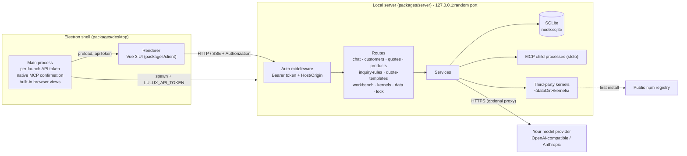

<div align="center">


# LULUX ETA

**A local-first AI agent workspace for foreign-trade (export) teams**

Customers, quotations, inquiry rules, and AI chat live on your own computer — only model requests leave it, and only to the model provider you configure.

[中文](./README.md) · [Architecture](./ARCHITECTURE.md) · [Changelog](./CHANGELOG.md) · [Security](./SECURITY.md) · [Contributing](./CONTRIBUTING.md)


</div>

> [!IMPORTANT]
> LULUX ETA is **source-available** software under the Business Source License 1.1. It is **not** an OSI-approved open source license. Individuals and organizations may use it in production for free (including modifying it internally), but may not sell it, distribute it for a fee, or offer it as a paid hosted service. See [License](#license).

## Screenshots

<!-- Replace with v0.1.1 UI before release: docs/screenshots/workbench.png, customers.png, quote.png, kernels.png, chat.png -->


## Why LULUX ETA

Export sales reps juggle inquiries, customer records, quotations, and outreach emails all day. LULUX ETA puts them in one desktop app and lets AI agents work right next to that data:

- **Local-first.** Data lives in a local SQLite database. No sign-up, no LULUX servers in the loop.
- **Bring your own model.** Any OpenAI-compatible or Anthropic endpoint (DeepSeek, Qwen/Tongyi, Moonshot, local Ollama, …).
- **Plug in third-party agent kernels.** One-click install of command-line agents such as Claude Code, Codex CLI, Gemini CLI, and Qwen Code — downloaded by your machine from public npm registries, never bundled with LULUX ETA.

## Features

### Available now (v0.1.1)

**Foreign-trade workflow**

- **Workbench** — customer totals by stage, quotation counts and amounts by currency, recent activities and sessions.
- **Customers** — company, country, website, stage (lead → contacted → quoted → negotiating → won/lost), tags, source, notes; multiple contacts (email, phone, WhatsApp); activity timeline (note / email / call / quote); search and filters.
- **Customer import** — CSV/Excel parsed locally, column mapping, de-duplication by email / company / website, skip or merge duplicates, per-row results.
- **Products & quotations** — product catalogue (SKU, spec, unit, price, currency, MOQ, HS code); quotations with Incoterms (EXW / FOB / CFR / CIF / DDP …), port, validity, payment terms, lead time, multi-currency, status (draft / sent / accepted / rejected); printable page and PDF export.
- **Quotation templates** — company header and logo, default Incoterm / currency / payment terms, footer, default template.
- **Inquiry rules** — conditions on subject / body / sender / domain (contains, not contains, regex) classifying mail as inquiry / spam / needs review, with priorities and a built-in tester.

**AI agents**

- **Multiple providers** — OpenAI-compatible and Anthropic Messages APIs, 12 presets plus custom base URLs, model discovery; API keys are only shown masked.
- **Kernel manager** — real install / update / uninstall of third-party CLI agents with version, progress, and logs; installed into the LULUX data directory, not globally.
- **LULUX personas + kernel agents** — LULUX's own personas run on your configured model; installed kernels appear under their real names. Every reply shows who actually ran it (which provider/model or which kernel and version).
- **Streaming chat & group chat** — SSE streaming with abort; several agents can take turns in one session.
- **MCP tools** — managed stdio MCP servers for both OpenAI and Anthropic tool-calling protocols; adding or changing a launch command requires a native confirmation dialog.
- **Tool approval** — allow/deny each call in the chat by default; call traces are stored with messages.
- **Artifacts panel** — code blocks collected from replies; HTML/SVG previewed in an isolated sandbox; copy and download.
- **Built-in browser** (desktop) — tabs with a separate session partition, isolated from your system browser cookies.

**Data & security**

- **Backup & restore** — one-click JSON export (without API keys, proxy, or webhook URLs); a local snapshot is taken automatically before every import.
- **Local lock** — optional 4–12 digit PIN (off by default).
- **Proxy & notifications** — HTTP/HTTPS outbound proxy; webhook on chat completion.
- **Hardened local API** — per-launch random token, Host/Origin checks, no CORS. See [Security model](#security-model).

### Coming soon

These appear in the UI as "Coming soon" and are **not available** yet:

- 📮 **Mailbox** — IMAP sync, SMTP send, 163/QQ app passwords and Gmail/Outlook OAuth, mail filed to customers
- 👥 **Teams & permissions** — members, roles, customer visibility
- 🌐 **Remote server sign-in** — connect to a self-hosted LULUX server (server mode)

## Installation

### Installers

Download the installer for your platform from [Releases](../../releases) (Windows `.exe` / portable, macOS `.dmg`, Linux `AppImage`).

> Early builds may not be code-signed yet, so Windows SmartScreen or macOS Gatekeeper may warn you. Only run installers downloaded from this repository's Releases page.

### Team server (self-hosted)

The same Release also ships the team server:

- `lulux-eta-server-<version>.tar.gz` — compiled server + web UI + production dependencies + Dockerfile / docker-compose / deploy configs. Unpack it and follow the bundled `README-server.md`: `docker compose up -d`, or `./start-server.sh` with Node.js 22.13+.
- Docker image: `docker pull ghcr.io/koko2376/lulux-eta:latest` (or a version tag such as `:0.1.1`).

See [docs/deploy-server.md](./docs/deploy-server.md) for the deployment guide.

### First run

1. Open **Settings → Models & Keys** and add a provider (pick a preset, paste your API key).
2. Go to **Agent**, start a new session, and chat.
3. Optional: install a third-party kernel under **Settings → Kernels**. Some kernels require a separate login with their vendor.

## Development

Requires Node.js **≥ 22.13** (uses the built-in `node:sqlite`).

```bash
npm ci                 # use `npm ci --include=dev` if your npm config omits dev deps
npm run dev            # API (http://127.0.0.1:51789) + web UI (http://localhost:51790)
npm run dev:desktop    # build, then launch the Electron app
npm run build          # build all packages
npm run dist           # build desktop installers → packages/desktop/release/
```

In browser dev mode the server writes the API token to `<dataDir>/api-token` and the Vite dev proxy injects it.

| Variable | Default | Description |
| --- | --- | --- |
| `LULUX_ETA_HOST` | `127.0.0.1` | Listen address (keep it on loopback) |
| `LULUX_ETA_PORT` | `51789` | API port (the desktop app picks a random free port) |
| `LULUX_ETA_HOME` | `~/.lulux-eta` | Data directory (SQLite, backups, kernels, api-token) |
| `LULUX_ETA_CLIENT_DIST` | empty | Built web UI to be served by the server |
| `LULUX_ETA_URL` | empty | Desktop app loads this URL instead of starting a local server |

See [CONTRIBUTING.md](./CONTRIBUTING.md) and the API contract in [docs/API-CONTRACT.md](./docs/API-CONTRACT.md).

## Architecture



Layers, data model, and data flows are described in [ARCHITECTURE.md](./ARCHITECTURE.md).

## Security model

- The local server listens on `127.0.0.1` only. **Do not** expose it to your LAN or the internet (no multi-user isolation yet).
- A random token is generated on every launch and required on every `/api/*` request; `Host` and `Origin` are validated and no CORS headers are sent, blocking cross-site calls and DNS rebinding.
- MCP launch commands need native confirmation; agent tool calls are approved one by one by default; model-generated HTML is previewed in a sandbox that cannot reach the local API.
- API keys are stored in the local data directory and only returned masked. Protect your data directory and backups.
- The local lock is a PIN against casual access, not encryption.

Please report vulnerabilities privately as described in [SECURITY.md](./SECURITY.md).

## License

LULUX ETA is licensed under the **[Business Source License 1.1](./LICENSE)** (the official MariaDB text with only the Parameters filled in).

| Parameter | Value |
| --- | --- |
| Licensor | koko |
| Licensed Work | LULUX ETA, © 2026 koko |
| Change Date | 2030-10-20 |
| Change License | Apache License, Version 2.0 |

**Additional Use Grant, in plain words** (the English text in [LICENSE](./LICENSE) governs):

- ✅ Any individual or organization may use LULUX ETA in production **free of charge**, including modifying it and using modified versions within the organization.
- ✅ You may copy, modify, and redistribute the source for non-production use (the base BSL grant).
- ❌ You may not **sell, distribute for a fee, or sublicense** it (or a modified version) to third parties, or offer it as a **paid hosted / online service (SaaS)**.
- ❌ You may not remove or obscure copyright notices, or distribute it (or a modified version) **as your own original product**.
- ⏳ Each version converts to Apache-2.0 on its Change Date (2030-10-20 for this version) or four years after its first public release, whichever comes first.

For any other use, contact the author for a separate license: kokozenshii0308@gmail.com.

BSL 1.1 is not an OSI-approved open source license, and GitHub shows it as "Other". That is why we call this project **source-available** rather than open source.

## Acknowledgements & trademarks

- Open source components and their licenses are listed in [THIRD_PARTY_LICENSES.md](./THIRD_PARTY_LICENSES.md) and [NOTICE](./NOTICE).
- Claude, Claude Code, Anthropic, Codex, OpenAI, Gemini, Google, Qwen, Tongyi, Alibaba Cloud and other names are trademarks of their respective owners and are used only to identify the corresponding third-party software. **LULUX ETA is not affiliated with, sponsored by, or endorsed by Anthropic, OpenAI, Google, Alibaba Cloud, or any other model vendor.**
- Third-party kernels are downloaded by the user's own machine from public npm registries, are governed by their own licenses, and are not distributed with LULUX ETA.
- "LULUX", "LULUX ETA" and the LULUX logo belong to the author; the BSL grants no trademark rights.

## Contact

- Author: koko, based in Wenzhou, Zhejiang, China
- Email: kokozenshii0308@gmail.com
